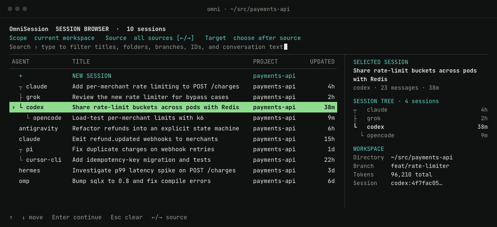
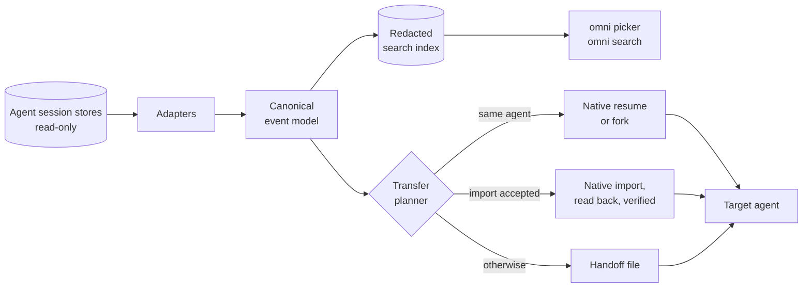

<p align="center">
  
</p>

<h1 align="center">OmniSession</h1>

<p align="center"><strong>Switch agents. Keep the thread.</strong></p>

<p align="center">
  <code>omni</code> finds every coding-agent session on your machine and continues the one you pick in the agent you want next.<br>
  It works with Claude Code, Codex, Cursor, OpenCode, Grok, Antigravity, Pi, Oh My Pi, and Hermes.
</p>

<p align="center">
  <a href="https://github.com/bvolpato/omnisession/actions/workflows/ci.yml"></a>
  <a href="https://github.com/bvolpato/omnisession/actions/workflows/provider-conformance.yml"></a>
  <a href="https://github.com/bvolpato/omnisession/releases/latest"></a>
  <a href="docs/COMPATIBILITY.md#platforms"></a>
  <a href="LICENSE"></a>
</p>

<p align="center">
  <a href="https://bvolpato.github.io/omnisession/"><strong>Try the live demo</strong></a> ·
  <a href="#install">Install</a> ·
  <a href="#quick-start">Quick start</a> ·
  <a href="docs/GUIDE.md">Guide</a> ·
  <a href="docs/COMPATIBILITY.md">Compatibility</a> ·
  <a href="#faq">FAQ</a>
</p>

<p align="center">
  <a href="https://bvolpato.github.io/omnisession/"></a>
</p>

## Why

You plan in Claude Code, implement in Codex, and review in Grok. Each agent keeps its own history and cannot see the others. When you switch, you explain everything again.

OmniSession reads all of those histories. Pick a session, pick an agent, and the conversation continues there as a real session of that agent. The original session does not change.

## Install

**Linux and macOS**

```sh
curl -fsSL https://raw.githubusercontent.com/bvolpato/omnisession/main/install.sh | sh
```

The installer verifies the release checksum and puts one binary, `omni`, in `~/.local/bin`. Add that directory to your `PATH` if it is not there.

**Windows x86-64 (preview)**, from PowerShell:

```powershell
irm https://raw.githubusercontent.com/bvolpato/omnisession/main/install.ps1 | iex
```

Other options are in the guide: [a different directory](docs/GUIDE.md#linux-and-macos), [Windows and WSL details](docs/GUIDE.md#windows-x86-64-preview), and [building from source](docs/GUIDE.md#from-source).

## Quick start

```sh
cd ~/src/my-project
omni
```

1. **Find.** Sessions from every agent are in one list, with this folder first. Type to search titles, branches, and conversation text. Press `Tab` to include every folder.
2. **Select.** Press `Enter` on a session.
3. **Continue.** Choose an agent and press `Enter`. OmniSession creates the session there, reads it back to verify it, and starts the agent.

You can also skip the picker:

```sh
omni search "rate limiter"                     # find a session
omni resume codex:<session-id> --in claude     # continue it in another agent
omni fork <session-id>                         # branch it, and choose where
omni doctor                                    # check what is installed and ready
```

## What you can do

| I want to | Command |
| --- | --- |
| Browse all sessions and continue one | `omni` |
| Find a session from a script | `omni --json search "rate limiter"` |
| Continue a session in another agent | `omni resume <session> --in codex` |
| Branch a session and keep the original | `omni fork <session> --in claude` |
| Branch it with a different model | `omni fork <session> --in codex --model <model>` |
| See what a transfer keeps and leaves out | `omni inspect <session> --target grok` |
| Preview a transfer without starting anything | `omni resume <session> --in codex --dry-run` |
| Save a session as Markdown | `omni markdown <session> -o session.md` |
| Paste the context into a chat app | `omni handoff <session>` |
| Move a session to another machine | `omni export <session> -o session.omnisession` |
| Start an agent through a gateway or a wrapper | A [launch profile](docs/PROFILES.md), then `--in <profile>` |
| Choose how much an agent may do without asking | [`--mode`](docs/GUIDE.md#permission-modes), or `←` `→` on the target page |

`<session>` is an ID such as `codex:4f7fac05`. The ID alone works when it is unique.

<details>
<summary><strong>Keys in the picker</strong></summary>

| Key | Action |
| --- | --- |
| Type | Filter by title, folder, branch, ID, and conversation text. `"Quotes"` match exactly. |
| `↑` `↓` | Move the selection |
| `Enter` | Continue the selected session |
| `Tab` | Show this workspace or all workspaces |
| `←` `→` | Show one source agent |
| `Shift-↑` `Shift-↓` | Scroll the preview |
| `Delete` | Delete the selected session, after you confirm |
| `Esc` | Clear the search, then quit |
| `F1` | Show every key |

The mouse works too. Click to select, double-click to open, and use the wheel to scroll.

</details>

## Supported agents

| Agent | Name for `--in` | Resume in the same agent | Continue here from another agent | Minimum version for import |
| --- | --- | --- | --- | --- |
| Claude Code | `claude` | Resume and fork | Yes | 2.1.220 |
| Codex | `codex` | Resume and fork | Yes | 0.146.0 |
| Cursor Agent | `cursor` | Resume | Yes | 2026.07.23-e383d2b |
| Cursor IDE | `cursor-ide` | Restore chat | Yes | 3.12.17 |
| OpenCode | `opencode` | Resume and fork | Yes | None (official API) |
| Grok | `grok` | Resume and fork | Yes | 0.2.114 |
| Antigravity CLI | `agy` | Resume | Yes | 1.1.8 |
| Pi | `pi` | Resume and fork | Yes | 0.79.3 |
| Oh My Pi | `omp` | Resume and fork | Yes | 18.2.10 |
| Hermes | `hermes` | Resume and fork | Yes | 0.19.1 |
| Antigravity Desktop and IDE | | Read-only | No, but you can continue their sessions elsewhere | |

All of this applies to Linux and macOS. On Windows, Codex and Grok are supported natively. [COMPATIBILITY.md](docs/COMPATIBILITY.md) has the details for each platform and agent. `omni adapters --check-imports` shows what is ready on your machine.

## Your sessions stay safe

- **Originals are read-only.** A transfer writes a new session. The only change OmniSession can make to a source is to delete the exact session that you select and confirm.
- **Everything is local.** There is no daemon, telemetry, or hosted service. The update check contacts GitHub, and `OMNI_NO_UPDATE_CHECK=1` turns it off.
- **Imports are verified.** OmniSession reads each new session back before launch. If an import fails, it rolls back what it can verify that it created.
- **History does not run.** Tool calls and shell commands carry over as records and never run again. Approvals, hidden reasoning, and permission state stay out.
- **Secrets are redacted.** The index, handoffs, imports, and exports redact recognized credentials. Authentication files are never read. Redaction cannot prove that every secret is gone, so review sensitive sessions before you transfer them.
- **You decide when an import cannot run.** OmniSession says why and asks: retry, fork in the source agent, continue with a handoff file, or cancel.

Read the full model in [SECURITY.md](SECURITY.md) and the [threat model](docs/rfcs/006-threat-model.md).

## How it works



Adapters read each agent's own store and map it to one [event model](docs/rfcs/001-canonical-event-model.md). The planner then uses the safest route that is available. A conformance run checks all 90 import paths between the ten import targets, and every result must match the original history. [ARCHITECTURE.md](docs/ARCHITECTURE.md) and the [RFCs](docs/rfcs/README.md) describe the design.

## FAQ

<details>
<summary><strong>Does OmniSession change my original sessions?</strong></summary>

No. A transfer opens the source read-only and creates a new session in the target agent. If you resume a session in place in its own agent, that agent continues to append to it.

</details>

<details>
<summary><strong>What carries over when I switch agents?</strong></summary>

User and assistant messages carry over in order, with bounded tool activity. When an import leaves out available history, the new session gets the path of a private Markdown file that has the rest. `omni inspect <session> --target <agent>` reports what one route preserves, summarizes, or omits.

</details>

<details>
<summary><strong>Does anything leave my machine?</strong></summary>

OmniSession sends nothing except the update check. The agent that continues a session receives its history and keeps its own network behavior.

</details>

<details>
<summary><strong>My agent is older than the minimum version. What happens?</strong></summary>

The native import cannot run. On a terminal, OmniSession asks what to do. Scripts and pipes fall back to a handoff file when the target supports one. Update the agent to use native imports.

</details>

<details>
<summary><strong>The picker is empty. What now?</strong></summary>

Press `Tab` to include every workspace. If the list is still empty, run `omni doctor` to see session counts and discovery notes. The guide has more [troubleshooting](docs/GUIDE.md#troubleshooting).

</details>

<details>
<summary><strong>Do <code>claude</code>, <code>codex</code>, and the other commands still work as before?</strong></summary>

Yes. OmniSession installs only `omni`. Commands such as `claude --continue` and `codex resume` go directly to their agents.

</details>

<details>
<summary><strong>Is OmniSession affiliated with these agents?</strong></summary>

No. OmniSession is independent, and the owners of these agents do not endorse it.

</details>

## Documentation

- [Guide](docs/GUIDE.md): the complete manual for install, search, transfers, modes, bundles, configuration, and troubleshooting.
- [Launch profiles](docs/PROFILES.md): gateways, wrappers, and custom arguments.
- [Compatibility](docs/COMPATIBILITY.md): versions, platforms, and details for each agent.
- [Architecture](docs/ARCHITECTURE.md), [RFCs](docs/rfcs/README.md), [performance](docs/PERFORMANCE.md), and [roadmap](docs/ROADMAP.md).
- [Changelog](CHANGELOG.md).

## Contributing

Contributions are welcome. [CONTRIBUTING.md](CONTRIBUTING.md) explains setup, validation, and the test policy. Design changes start as [RFCs](docs/rfcs/README.md).

Report vulnerabilities through [private vulnerability reporting](https://github.com/bvolpato/omnisession/security/advisories/new). Do not put secrets or transcript data in a public issue.

## License

[MIT](LICENSE)
