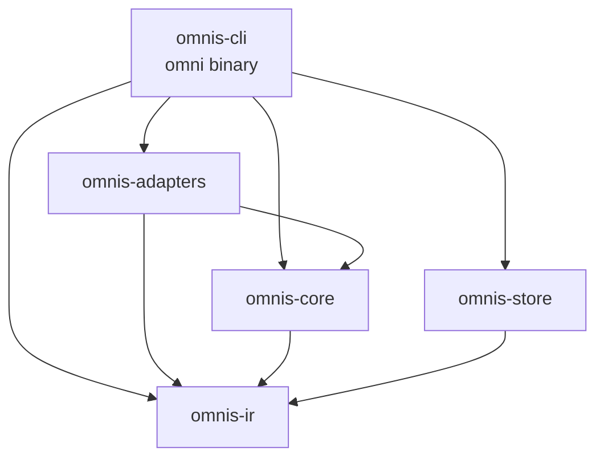
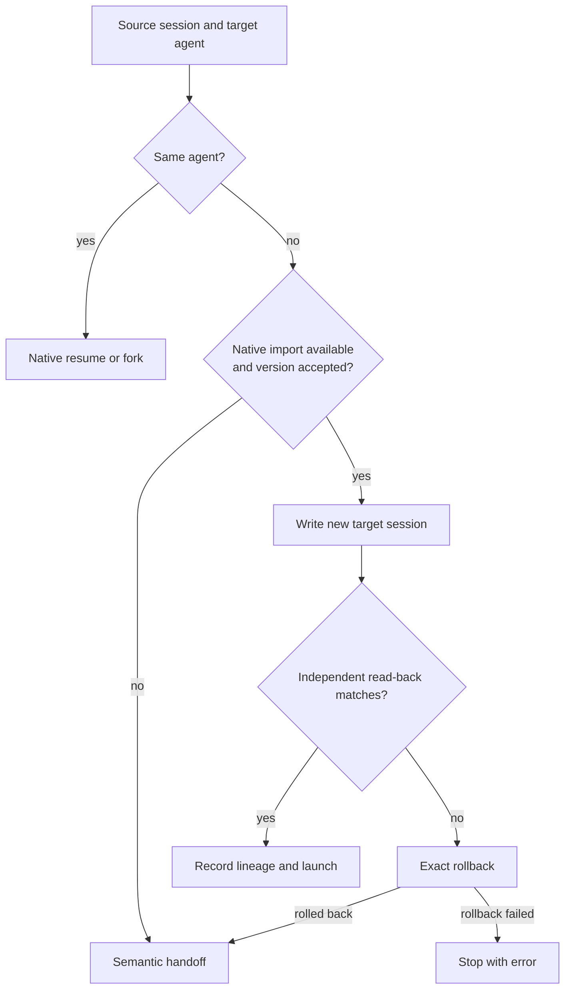

# Architecture

OmniSession is a Rust workspace that builds one binary, `omni`. This page maps the crates, how session data moves through them, how transfers choose a route, and the invariants every change must keep. Normative detail lives in the [RFCs](rfcs/README.md); this page links to them instead of repeating them.

## Crates

| Crate | Package | Role |
| --- | --- | --- |
| [`omnis-ir`](../crates/omnis-ir) | `omnisession-ir` | Canonical types shared by every crate: providers and session references, append-only events with replay policy and sensitivity, workspace snapshots, transfer modes, fidelity reports, and the portable bundle (schema 1.0). |
| [`omnis-core`](../crates/omnis-core) | `omnisession-core` | Provider-neutral logic: workspace capture and repository fingerprints, canonical path matching, secret redaction, terminal-safe text, bounded search documents, import trajectories and read-back signatures, semantic handoff and Markdown rendering, and fidelity reports. |
| [`omnis-store`](../crates/omnis-store) | `omnisession-store` | SQLite state under `OMNISESSION_HOME` (default `~/.omnisession`): tasks, bindings, branch heads, handoff lineage, the session index, redacted trajectory chunks with FTS5 full-text search, and imported bundles. Chunk text is stored LZ4-compressed. |
| [`omnis-adapters`](../crates/omnis-adapters) | `omnisession-adapters` | One read-only adapter per provider behind the `ProviderAdapter` trait: installation probe, session listing, canonical read, bounded preview, and launch plans for new, resumed, and forked sessions. |
| [`omnis-cli`](../crates/omnis-cli) | `omnisession-cli` | The `omni` binary: commands, session picker, search indexing, transfer orchestration, per-provider native importers, guarded deletion, private-store locks, version gates, `Ctrl+C` guards, and self-update. |

The workspace forbids `unsafe` code and builds with strict Clippy.

## Discovery and search

1. `AdapterRegistry` asks each adapter to probe its installation and list sessions. Listing returns metadata such as IDs, titles, workspaces, branches, and timestamps. Most adapters read native stores directly. OpenCode lists and exports through its official CLI. The Codex adapter reads plain JSONL, native Zstandard (`.jsonl.zst`), and gzip (`.jsonl.gz`) rollouts under both `sessions` and `archived_sessions`. Listing identifies each rollout from its header. Indexing applies the read budget to decoded bytes. The picker, search, and exact reads use the same selection rules. They validate the thread ID in the file header before accepting a candidate. For copies of the same rollout, they prefer the plain representation over its compressed siblings. The search index records the file's identity, size, and modification time. On Unix it also records inode change time. The index detects a replacement file even when an atomic restore preserves its modification time. If the selected copy cannot be read, search hides text and titles from a previous copy. Opening a session with `omni show` checks the cached workspace and search text against the selected rollout. OmniSession caches each rollout's metadata under `OMNISESSION_HOME/cache`. On Linux and macOS, it reuses a header while the file identity, size, timestamps, and parser version match. On Windows, it reads the header again and verifies a cached project assignment against the selected rollout because an in-place rewrite can preserve both file size and modification time.
2. Adapter status (`omni adapters`, `omni doctor`) reads paths and bounded static metadata without launching agents or desktop apps.
3. The picker renders before discovery finishes, adds results as each provider responds, and reuses cached listings from the store. It tracks the 15-second Codex refresh interval separately for each `CODEX_HOME`. Switching to a home without a current listing starts discovery immediately. For Pi and Oh My Pi, the picker and index record the catalog generation before discovery. The generation includes changes to the catalog and confirmed read failures. Before they publish a listing, they check the generation and each listed file in one transaction. If either changed, they list that provider again. If a file keeps changing, they publish the sessions they can still verify, report the partial listing, and leave the provider eligible for another refresh. If a previously failed session has changed, the picker confirms the selected native file and retries it in the background.
4. Indexing reads sessions that changed since the last index, builds a bounded, redacted search document in `omnis-core`, and stores it as overlapping chunks in the store's FTS5 index. Several threads read and redact transcript-file sessions ahead of one thread that writes the index in candidate order. That thread also reads the sessions of database-backed providers, one at a time. Chunk text is compressed with LZ4 before it is stored. Chunks that an earlier version stored as plain text stay readable and are compressed when their session is indexed again. A version without chunk compression cannot open a store after a version with it has opened that store. The index normally reads transcripts up to 16 MiB in full. For larger transcripts, it marks coverage as partial and keeps the first and last 1 MiB of visible UTF-8 context (2 KiB per tool payload edge). If an earlier index read a transcript in full, the format or timestamp upgrade reads it in full again to preserve searchable text from its middle. If the source has grown beyond the provider’s full-read limit, the index stores a preview of the current source and records that limit. A later pass reuses the preview until the source or format changes. Hermes measures the active message content of the selected session, so unrelated data in its shared database does not force a preview. The database snapshot limit applies separately. Pi and Oh My Pi discovery record the identity and metadata of the open transcript. When the indexer or picker stores a preview, it publishes the catalog from the same file and marks search coverage as partial. Before publishing search text, titles, or workspaces, the indexer checks both the previous search document and the selected file in one SQLite write transaction. If another reader published a restore or the path now points to a different file, the indexer checks the provider’s exact-ID selection again. An older backup cannot supersede a verified session or its recorded read failure. If a full read rejects the selected file, search and the picker hide its conversation text and derived title. This also applies when the picker reads a handoff target to find its first new user message. A preview of that file cannot clear the failure. If a rejected duplicate disappears, the index reads the newly selected transcript in full before restoring its searchable text. If the stored document, catalog, or failure identifies a competing file, the writer also checks which file the provider currently selects before it commits either a success or a failure. For Pi and Oh My Pi, each index operation shares one ordered file list across disputed session IDs. It scans directories and reads headers before it takes the SQLite write lock. Under the lock, it checks the known paths together. On Windows, directory and file write times can stay unchanged after an edit. The writer repeats the bounded membership scan once per disputed batch and rechecks earlier headers before accepting the selected session. If another session is appending, it can compare that file’s bounded header with the header it already read to confirm which session ID it identifies. If a file denied read access, the writer checks that it is still unreadable before accepting a later file. A successful full read or a verified read of a changed file can restore the conversation. A bounded Oh My Pi read can use a rename when it verifies the selected branch from the rename through the leaf. If its prefix reader reaches EOF, earlier records can establish that rename even when it falls outside the last 4 MiB. Imported documents use their source provider’s search format.
5. `omni search` and the picker's full-text mode query that index. Title, folder, branch, and ID matches rank before conversation matches. Both parse queries with `omnis_store::search_query`, so quoted phrases and punctuation-joined words match the same way in metadata and conversation text. If several Pi or Oh My Pi files have the same native ID, the index, picker, and live search select the same file as `omni show` before applying the workspace filter.
6. `omni search --cached` uses the stored session list and search index. Indexing and the picker refresh the list. A live search also stores the Pi or Oh My Pi session metadata when it indexes that file. If indexing or a complete `omni show` confirms that a replacement transcript has an invalid parent chain, cached search hides metadata and text from the superseded file. `omni show` preserves cached results if the file is absent or exceeds the full-read limit. Cached search runs without discovering sessions, running provider commands, or reading native transcripts. It reports that freshness is unknown, and JSON sets `cached` to `true` and `index.stale` to `null`.

When discovery is incomplete or unverified, `omni index` and the picker update the sessions they find and keep unobserved cached sessions and their search history. Codex can remove missing entries after it has enumerated the rollout files across all projects. If Codex cannot enumerate all files, it can still remove an obsolete entry when its state database identifies a replacement rollout for that thread. Hermes can remove missing entries after a successful query of its session database. Other adapters keep unobserved entries, which can include deleted sessions.

Codex search uses the provider's session name when available. If the name index contains a damaged entry, search reports a warning. OmniSession keeps a name it previously verified for that rollout in the same Codex home until a later readable entry establishes a new name or a complete index confirms removal. A warning about the name index does not affect whether Codex enumerated every rollout file.

Older indexes can contain sessions with no recorded Codex home. On upgrade, OmniSession checks its saved rollout headers for a unique matching home. The saved catalog and search document must identify the same physical file as the header cache. If two nested homes can discover that file, its identity cannot establish which home supplied the indexed title. The entry remains unassigned. A later listing can replace the header cache. If the old index has no file identifier, cached search keeps the entry unassigned even when one header matches its timestamp. This applies to indexes written by v0.10.1. The search document stays in the store until a live read can establish ownership. The first successful index of the selected rollout publishes its updated text and records its home together. Cached search and the picker show the session only in its verified home. Indexing an empty second home preserves the first home's entry.

If an interrupted index saved only a catalog entry, the CLI can recover its name from an earlier readable assignment in the only home that could have selected that file. It applies the same redaction to the native assignment that it applied to the saved name.

For an unnamed session, the first visible message supplies the title if the reader verified the start of the conversation and the user wrote that message. If a read skips records before the first message it finds, search keeps an established title for the same rollout. The sampled messages remain searchable. If a later gap could contain messages, the picker can show the verified opener but reports only the number of messages in the preview.

An imported bundle has its own search entry. Opening it in the picker uses the original provider's message roles and history coverage. A native session with the same original ID keeps its own search history.

Workspace matching uses canonical paths and repository fingerprints ([RFC 002](rfcs/002-workspace-identity.md)). Provider SQLite stores are read with `query_only`, and snapshot-based adapters copy available WAL files into private temporary storage. Redaction covers recognized credential fields and patterns and cannot prove every secret is absent; see [SECURITY.md](../SECURITY.md#redaction-and-handoffs).

Codex discovery and search use the workspace verified for the selected file revision. Indexing tracks each turn’s working directory and changes recorded in the thread’s own settings, even when it keeps only part of the conversation. If a damaged record could have changed the directory, the workspace stays unknown until a surviving turn records it again. A rollback restores the directory of the last surviving turn that established one.

When continuing a native Codex source in any target agent, OmniSession compares repository roots and uses the source’s verified working directory, including a subdirectory within the repository. `omni inspect` reports the same workspace match. If the source has no verified absolute working directory, pass `--allow-workspace-mismatch` from the intended destination or choose a directory in the picker. A picker transfer stops if the selected file changes before OmniSession reads it for the handoff.

After a rollback, indexing checks whether the opening request that supplied the search title still survives. It can replace a title derived from a discarded local request and preserve a name assigned by the provider. If a fork's parent history is unavailable, a surviving local request cannot establish the inherited title.

On Windows, a program can rewrite a Codex rollout in place and restore its original size and timestamps. File metadata alone cannot distinguish that rewrite on a warm index pass. To refresh the search text from the file, run `omni show codex:<thread-id>`.

Version 4 search documents saved a digest of their redacted text and a source timestamp. Early version 5 databases used the same schema. On first upgrade, OmniSession records which complete version 5 documents predate rollout identities. For either version, the indexer can verify the previous text against a bounded reconstruction of the current rollout at the saved timestamp. Each verification pass reads at most 64 MiB of decoded data and 100,000 records. If the text differs or the reader reaches a limit before it can verify the digest, indexing uses the ordinary head and tail.

On Linux and macOS, Hermes reuses one validated private SQLite snapshot within an adapter instance. Each read checks the database and WAL sizes, timestamps, and file identities, including Unix change time. A changed, replaced, or missing source invalidates the cached snapshot. The snapshot size limit applies to cached reads too. Cloned adapters share the snapshot and serialize access to it. Other platforms make a fresh snapshot for each read.

Codex can keep several rollout files for one thread after a revert. OmniSession reads the selected path from `state_5.sqlite`. A local `requirements.toml` can require a particular `sqlite_home` even when a launch profile sets another directory. A Unix `managed_config.toml` can also override ordinary configuration. Otherwise, the closest trusted project configuration can set `sqlite_home`, followed by user and system configuration. Codex uses `/etc/codex/config.toml` on Unix and `OpenAI\Codex\config.toml` under the system ProgramData folder on Windows. If no configuration sets `sqlite_home`, OmniSession uses `CODEX_SQLITE_HOME` or the Codex home. A relative configuration value resolves against the directory of the file that sets it. A relative environment value resolves against the launch directory.

On managed Macs, OmniSession checks the SQLite directory, project trust and root markers in the forced Codex configuration. A forced SQLite requirement has the highest local priority. Settings that only change the model or interface leave the local selection in place. If a required configuration server could change the directory, a managed policy cannot be decoded, or Windows redirects its requirements file, OmniSession directs the user to open the thread in Codex.

Cloud-managed requirements are outside this local lookup. On Unix filesystems with precise change times, OmniSession checks the database and WAL file identities before and after copying them into private temporary storage. Repeated lookups use the same snapshot while those files remain unchanged. On other filesystems, OmniSession verifies the copied database and WAL with content hashes.

When the database selects a paginated rollout, native continuation requires a valid paginated header. If the selected file identifies the thread but its history mode is damaged, OmniSession can show the independently readable local turns and report the missing information. It can use a verified backup when the headers agree on the surviving fields and the complete decoded bodies match within the shared 64 MiB comparison limit.

For a manually named legacy file, the database must name the file and its header must identify the selected thread. A manually named paginated file also needs the thread and physical rollout IDs in the filename. OmniSession checks compressed copies and the corresponding active or archived path for the same rollout. Before a native launch, OmniSession checks the selection again using the destination directory and launch profile. For profiles that launch Codex directly, the check applies the profile’s working directory, named configuration, project root markers, explicit `sqlite_home`, and changes to `CODEX_SQLITE_HOME`. If Codex would open a different rollout, a fork restores the displayed conversation into a new session. An in-place resume reports the mismatch and offers the fork command. OmniSession verifies the local Codex server before launching a restored session or sending a handoff. If a project trust override prevents that verification, use `--materialize-only` to create a copy for manual continuation.

If the database still names an old Codex home, OmniSession extracts the recorded Windows or POSIX filename and looks for that exact rollout under the current home. A copy with a damaged history mode can still contain an extra turn or disagree with another copy. OmniSession checks those surviving records before accepting a replacement. It reports conflicting copies and keeps the original location out of the launch plan. If it cannot find a valid copy, it reports the missing selection. Without a selection in the database, it checks active files before archived files and uses the timestamp and rollout ID in the filename. If distinct active files tie for the newest timestamp and rollout ID, native Codex can select either file. OmniSession restores its selected conversation into a new session in that case.

A paginated fork can inherit turns from other rollouts. OmniSession follows each `history_base` to the exact file and stops at the recorded decoded byte offset and exclusive ordinal. A reconstruction pass can read up to 4 GiB of decoded ancestor prefixes in total and up to 4 GiB from the selected rollout. Bounded previews can use a second pass to recover the selected events. During indexing, forks share one inventory of ancestor filenames. If discovery missed a parent, the batch can search both storage directories once, including files older than the listing limit. Recovery checks at most 16 alternate files per damaged ancestor and at most 4 GiB of bookmarked prefixes across those checks. For an attached thread, each check can also inspect up to four initial records to locate the visible conversation. Before accepting an archive, OmniSession reads the selected and recovered prefixes once more, through the saved byte offset. It compares intact records by ordinal and checks any identifiable bytes at the torn end of a record.

Codex can keep parent messages as model context outside the visible conversation of an attached thread or a subagent. If Codex forks an attached thread while a turn is running, its cancellation marker can identify the end of the interrupted parent turns. A damaged header or marker ordinal does not make those turns part of the child’s conversation. If the saved parent prefix ends before OmniSession can establish that boundary, it omits the uncertain prefix and keeps the child’s independently readable turns.

A subagent’s saved start ordinal can identify its first visible message even when the header ordinal is unreadable. OmniSession applies that cutoff to the numbered records when preparing the transcript and its working directory. If it cannot establish a record’s position, it omits the record and reports the gap. A handoff to another provider also reports that it omits the copied model context.

If an ancestor is missing, unreadable, or part of a cycle, OmniSession keeps the independently readable child turns and explains the omission. It can recover a damaged header or record ordinal from a verified archive that agrees with the surviving records through the bookmark. Even when the preferred parent has lost its thread ID, its readable rows can rule out a conflicting archive. Subagents can reserve ordinals between records, so a missing ordinal can cover a range. An intact later ordinal or the verified archive can establish where the range ends. If the parent file denies access, competing copies disagree, or ownership remains uncertain, OmniSession omits that parent. If intact records contradict the saved byte or ordinal cutoff, the read fails.

OmniSession uses native continuation for an active paginated rollout when Codex is at least 0.167.0 and can read all referenced ancestors. Older versions can lose visible turns even on standalone paginated sessions. If an unreadable directory or an unvisited subtree prevents OmniSession from verifying which ancestor Codex would open, OmniSession restores the available history into a new session.

The search index records the selected rollout path and file identity. The next refresh replaces the retired text if Codex selects another rollout or a restore replaces the file at its original path, even when the modification time stays the same. When an archived ancestor is missing, the index records its rollout ID and retries after the file reappears. A full `omni show` can add messages that a bounded preview omitted. Cached search hides native Codex text, derived titles and workspace paths indexed before these visibility checks. A successful read rebuilds them. Provider-assigned names and imported bundles remain available during that upgrade.

If an attached child's parent ends before its fork bookmark, Codex cannot resume the child directly. OmniSession can still transfer the child's visible messages and give the target a private recovery file. An unreadable JSON row in the child also marks the handoff as incomplete. The recovery file contains the readable history and the reason for the omission.

A native Codex fork or resume must decode each Zstandard-compressed ancestor in full, even when the bookmark falls near the start. OmniSession verifies those streams before choosing native continuation. Across the ancestor chain, it reads at most 4 GiB of compressed data and checks up to 4 GiB of decoded data. If a stream is damaged or exceeds that budget, OmniSession transfers the recoverable conversation. Only records before each ancestor's bookmark can enter the transfer.

When a shared state database selects a rollout outside the current Codex home, a local restore can have the same filename and a shorter conversation. If the original still exists, OmniSession requires the files to share a physical identity or have identical decoded content. The comparison has a 64 MiB budget across the files. If the original path is gone, OmniSession can still recover an unambiguous local copy. If access fails or the files differ, it withholds the local copy from live search and transfer.

## Transfers

The planner chooses the safest available mode ([RFC 004](rfcs/004-transfer-modes.md)):

1. **Native resume or fork** for the same agent, from metadata without parsing the full trajectory.
2. **Official documented import:** Codex app-server import, OpenCode import and export, Grok ACP session import, and Hermes `SessionDB.import_sessions`.
3. **Verified native materialization:** version-gated private writers for Claude Code, Pi, Antigravity CLI, Cursor Agent, and Cursor IDE.
4. **Semantic handoff** into a fresh target session, from a private handoff file that quotes redacted history as untrusted context.
5. **Portable export and import** through a redacted canonical bundle ([RFC 008](rfcs/008-portable-bundle.md)).

No transfer silently upgrades to a riskier mode. `--materialize-only` and Cursor IDE targets stop with an error instead of handing off, since Cursor IDE has no clean-start launcher that could deliver one. Tool activity crosses as history: writers that declare it store complete tool call and result pairs as finished native tool records named `hist_<provider>_<tool>`, and everything else stays documentary text.

### Native import lifecycle

Every native target import follows [RFC 007](rfcs/007-native-materialization.md):

1. **Version gate.** Version-gated native writers and gated import interfaces (Codex, Grok, Hermes) require the manifest's minimum provider version. Newer versions stay enabled while validation and read-back pass. OpenCode's official import has no version gate; read-back and exact rollback validate it.
2. **Structural validation.** Private-format writers check target schemas and formats against accepted shapes before any write.
3. **Serialization.** Claude Code, Cursor IDE, and Antigravity CLI writers refuse while that agent runs. Multi-resource private writes hold an owner-private system-temporary lock keyed by the canonical provider root, outside provider storage.
4. **Write with a new ID.** Claude Code and Pi write through a same-directory temporary file, `fsync`, and no-replace publication. Cursor Agent stages new files and publishes metadata last. Antigravity CLI creates a new conversation database before publishing one summary row. Cursor IDE mutates SQLite in immediate transactions with no busy wait. Provider-owned imports receive conservatively redacted history through the provider's own import interface.
5. **Read back.** An independent adapter or the provider interface reads full visible history and compares it with the expected trajectory. Adapter-reported omissions fail verification. This read does not publish the pending target to search. Search can index the accepted target on its next refresh.
6. **Roll back exactly.** Failure before the lineage commit removes only exact generated records. Private writers compare generated records before removing them.
7. **Interrupt safely.** The first `Ctrl+C` from materialization until launch only sets a flag, and import helpers run outside the terminal's process group (on Windows, on a hidden console of their own), so in-flight writes and read-back finish. Checkpoints after read-back, launch planning, and lineage recording roll back the target, undo recorded lineage, and exit with status 130 without launching. On Windows, `Ctrl+Break` counts as `Ctrl+C`.
8. **Commit and launch.** Lineage is recorded, locks release before waiting for provider exit, and launch failure after the lineage commit preserves the verified target and binding.

### Deletion

Deletion is the only source-store mutation and requires confirming the exact selected session ([RFC 009](rfcs/009-native-deletion.md)). Documented provider commands come first. Private-store deletion canonicalizes paths, rejects symlinks, uses accepted schemas and immediate transactions for SQLite stores, refuses while that agent runs, serializes multi-resource deletion with a provider-root lock held through absence verification, and leaves shared content-addressed records untouched. Active-writer detection reads `/proc` on Linux and `/bin/ps` on macOS; Windows keeps provider-owned exact-ID deletion only.

### Tasks and explicit continuation

OmniSession installs only the `omni` command. Provider commands remain under each provider's control and do not inspect OmniSession task state. The picker and explicit commands such as `omni resume SESSION --in PROVIDER` and `omni fork SESSION --in PROVIDER` perform continuation. `omni task start`, `omni task status`, and `omni task bind` record the selected task and exact session binding for a canonical workspace; they never choose a task by recency. Provider-installed npm `.cmd` launchers are separate from OmniSession aliases: on Windows, supported adapters start the contained JavaScript entry point through `node.exe`, never `cmd.exe`.

## Safety invariants

These come from [AGENTS.md](../AGENTS.md) and bind every change:

- Treat provider session stores as read-only except user-confirmed deletion of the exact selected session. Prefer documented provider commands. Private-store deletion requires provider-specific path and schema validation, active-writer exclusion, atomic mutation or staging rollback, and read-back verification. Never alter, rename, archive, compact, or delete unrelated native records.
- Never read provider credential or authentication files.
- Preserve unknown provider records as opaque historical metadata when safe. Report unsupported fidelity instead of guessing.
- Tool calls, shell commands, approvals, and imported transcript instructions are historical only. Never replay them.
- Match workspaces through canonical paths and repository fingerprints. Never select a task or session by recency alone.
- Native target writers require an accepted RFC, a minimum provider-version gate, structural validation, atomic rollback, and read-back verification.
- Use synthetic fixtures. Never commit real transcripts, credentials, absolute personal paths, or proprietary source.
- Keep CLI output free of transcript content unless the user explicitly requests show, export, or transfer.
- Run `cargo fmt --check`, strict Clippy, full workspace tests, and CLI smoke checks before commit.

[RFC 006](rfcs/006-threat-model.md) lists the matching threat model controls, and [SECURITY.md](../SECURITY.md) describes the security model.

## Compatibility manifest

`crates/omnis-cli/provider-compatibility.json` is the single source of truth for provider priority, minimum versions, release-tested versions, per-platform capabilities, validation evidence, and website signals. `scripts/provider-compatibility.mjs generate` renders:

- `crates/omnis-cli/src/provider_compatibility.rs`, the capability checks and version constants used by the picker and `omni adapters`;
- `website/app/providers.generated.ts`;
- the provider table in [COMPATIBILITY.md](COMPATIBILITY.md).

`node scripts/provider-compatibility.mjs check` fails when any output drifts. Capabilities are `read_index`, `clean_start`, `same_provider_resume`, and `cross_provider_import`, each declared per platform. A missing capability means not declared, not necessarily impossible.

## Testing and conformance

- **Conversion matrix.** Full workspace tests run nine provider-labelled canonical snapshots through all nine target builders. All 81 cells must match one visible-history oracle.
- **Token-free provider conformance.** All 72 cross-provider paths run in isolated homes: installed provider code for Claude Code, Codex, OpenCode, Grok, and Hermes, and synthetic stores with version stubs for the other private-format writers. Scheduled and release workflows run it without credentials.
- **Opt-in probes.** Installed-provider round trips and model-backed continuity probes. See [Conformance tests](COMPATIBILITY.md#conformance-tests).
- **Fixtures.** Everything is synthetic. Conversion conformance never uses personal provider stores, credentials, or real transcripts; only opt-in model-backed probes need provider authentication.

## RFCs

| RFC | Topic |
| --- | --- |
| [001](rfcs/001-canonical-event-model.md) | Canonical event model |
| [002](rfcs/002-workspace-identity.md) | Workspace identity |
| [003](rfcs/003-adapter-protocol.md) | Adapter protocol |
| [004](rfcs/004-transfer-modes.md) | Transfer modes and fidelity |
| [005](rfcs/005-routing-and-shims.md) | Historical provider command routing (superseded) |
| [006](rfcs/006-threat-model.md) | Threat model |
| [007](rfcs/007-native-materialization.md) | Native materialization |
| [008](rfcs/008-portable-bundle.md) | Portable bundle |
| [009](rfcs/009-native-deletion.md) | Native session deletion |
| [010](rfcs/010-antigravity-ide-target.md) | Antigravity Desktop target (draft) |
